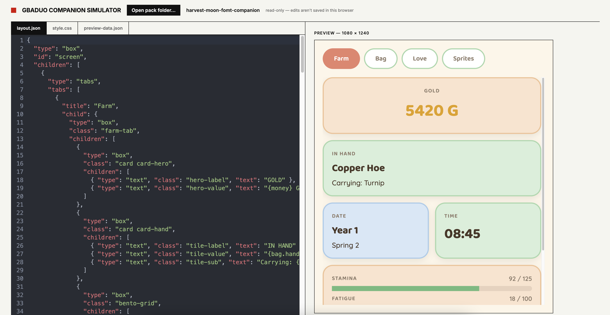

<div align="center">


<h3>Build GBADuo companion packs in the browser, see them the way the device does.</h3>

<p>
  <strong><a href="#getting-started">Getting started</a></strong>
  · <strong><a href="#opening-a-pack">Opening a pack</a></strong>
  · <strong><a href="#what-it-previews">What it previews</a></strong>
  · <strong><a href="https://github.com/khumam/gba-duo-companions">Packs</a></strong>
  · <strong><a href="https://github.com/khumam/gba-duo">GBADuo app</a></strong>
</p>

</div>

[GBADuo](https://github.com/khumam/gba-duo) shows a **companion pack** on the bottom
screen of a dual-screen handheld: a `layout.json`, a `style.css` and a Lua script that
reads the game. This simulator renders a pack in the browser with the app's own layout
and sizing rules, so you can edit the layout, CSS and sample data side by side and see
the result straight away, without rebuilding or copying anything to the device.



## Getting started

You need Node.js 22.17 or newer.

```sh
git clone https://github.com/khumam/gba-duo-companion-simulator.git
cd gba-duo-companion-simulator
npm install
npm run dev
```

Open http://localhost:5173.

## Opening a pack

Click **Open pack folder…** and pick either:

- **a pack folder** (the one with `manifest.json`), or
- **a folder of packs** - every subfolder with a `manifest.json` shows up in the pack dropdown.

The left column edits `layout.json`, `style.css` and `preview-data.json`; the preview
updates as you type.

| Browser         | Edits                                    |
| --------------- | ---------------------------------------- |
| Chrome, Edge    | Saved back to the pack's files           |
| Firefox, Safari | Folder opens read-only, edits aren't saved |

Fonts and images load from the pack's `assets/` folder.

## What it previews

- **Layout and CSS** - the same widgets, selectors and properties as the app, on the
  same 1080 × 1240 screen (shown at 60%), with the app's sizing rules for flex, grid,
  tabs and scrolling.
- **Data** - `preview-data.json` stands in for what `update()` would return; edit it to
  try other values. A `ui` entry in it switches pages, like `update()` does on the device.
- **Taps** - tabs, buttons, `onClick` set / navigate / back. The **UI state** panel shows
  `$ui` (with a Reset), and a `call` action shows which Lua function the device would run.

It doesn't run the pack's Lua or a game, so `gfx:` sprites decoded by the script stay
empty. Always confirm the final look on the device.

<details>
<summary><strong>The app's default.css</strong></summary>

Packs are styled on top of the app's built-in `default.css`. The simulator reads it live
from the app repo when it's cloned next to this one; otherwise it uses a bundled copy and
shows a warning that it may be out of date.

```
gbaduo/                        the app (for its default.css)
gbaduo-companions/             the packs (optional, used by npm test)
gba-duo-companion-simulator/   this repo
```

The sibling folders must have exactly these names, so clone them like this:

```sh
git clone https://github.com/khumam/gba-duo.git gbaduo
git clone https://github.com/khumam/gba-duo-companions.git gbaduo-companions
```

</details>

## Tests

```sh
npm test
```

When `../gbaduo-companions` and `../gbaduo` are cloned next to this repo, the tests also
render the real packs with the app's real `default.css`; otherwise that part is skipped.

## Disclaimer

GBADuo and its packs are fan projects, not affiliated with or endorsed by Nintendo or any
game publisher. No games or game art are included.
